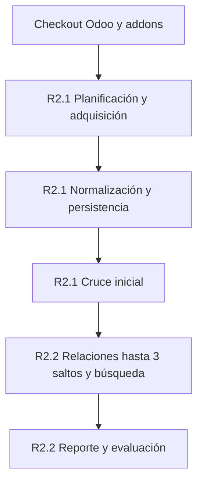

# Funcionamiento de R2

## Objetivo y alcance

R2 centraliza evidencia técnica de cambios entre versiones de Odoo y la cruza con addons para encontrar construcciones potencialmente afectadas antes de migrar. R2.1 comprende planificación, adquisición, normalización, persistencia y cruce inicial. R2.2 comienza con la extracción de relaciones y comprende recorrido, búsqueda, ordenación, reporte, CLI y evaluación. La clasificación depende de la función ejecutada aunque un comando coordine ambos resultados. El código de los addons se lee estáticamente.

## Flujo

### Entrada local

`r2 start` detecta `odoo-bin`, referencias Git y addons por `__manifest__.py`. Antes de comparar versiones, lee los manifiestos y el código de los addons sin ejecutarlos, amplía las dependencias personalizadas disponibles y obtiene dependencias núcleo, modelos y namespaces XML. Con esa evidencia selecciona directorios de addons de Odoo y archivos del framework relacionados. `git diff` compara los SHA elegidos solo sobre esas rutas, excluyendo traducciones, demostraciones, pruebas y descripciones estáticas. El diff filtrado se registra como artefacto local junto con el alcance que lo justificó, se construye una colección compartida y se consulta por cada addon seleccionado.

### Entrada web

`r2 plan` inspecciona estáticamente el addon y propone fuentes. Acquisition valida el catálogo, conserva bytes originales y registra estados `accepted`, `excluded`, `quarantined`, `incomplete`, `failed` o `deleted`. La descarga no decide relevancia.

### Experimento por grupo de cinco addons

`aws-lab/experimentos.py` descarga snapshots de los addons y del núcleo desde GitHub y fija sus SHA. El análisis conjunto de los cinco addons determina las rutas del diff local del núcleo entre origen y destino. El tamaño resultante depende de las referencias técnicas encontradas y queda registrado. Después se planifican y capturan fuentes web complementarias por addon, se deduplican URL y se fusionan los inventarios antes de normalizar. El experimento conserva el diff filtrado y omite el compare global que propone el planner genérico.

La colección es compartida por el grupo. R2.1 produce un cruce por addon y un agregado de coincidencias de los cinco en `initial-crossing.json`. R2.2 ejecuta después las consultas y guarda reportes y caminos por addon. Se comparan tres salidas, el grafo, BM25 por unidades como control y BM25 por fuentes completas. Este último indexa el texto completo de cada artefacto admitido conservado en SQLite. Sus resultados identifican fuentes y su procedencia.

La consulta BM25 usa términos de las entidades técnicas extraídas del addon.
La coincidencia y la ordenación son léxicas. La extracción de relaciones usa
identidades técnicas tipadas y sus caminos de evidencia.

Los MIG del addon para el salto se recogen después de las consultas en un dossier de referencia separado. Se conservan todos los commits cuyo asunto contiene `[MIG]`, nombre de addon y versión destino. La revisión determina elegibilidad, correcciones evaluables y utilidad. La recuperación por título no acredita por sí misma una verdad de referencia exhaustiva.

## Componentes

| Componente | Código | Responsabilidad |
|---|---|---|
| R2.1 Planificación y adquisición | `r2/adquisition/` | Preparar fuentes, aplicar política y conservar capturas. |
| R2.1 Normalización y persistencia | `r2/normalization/` | Crear unidades verificables y SQLite esquema 4. |
| R2.1 Cruce inicial | `r2/crossing/` | Localizar identidades técnicas exactas del addon. |
| R2.2 Relaciones | `r2/relations/` | Conectar unidades y recorrer de 0 a 3 saltos. |
| R2.2 Reporte y evaluación | `r2/report.py`, `r2/evaluation/` | Filtrar, presentar, validar y medir. |
| Interfaz R2.2 | `r2/cli.py`, `r2/assistant.py` | Exponer comandos y selección local de múltiples addons. |

## Datos

La colección activa usa `schema_version=4` y `layout=normalized-units`.

| Tabla | Contenido |
|---|---|
| `sources` | Procedencia y bindings de versión. |
| `artifacts` | Artefactos completos y hashes almacenados. |
| `information_units` | Hunks, secciones, texto, PR y otras unidades. |
| `unit_content` | Texto, datos del fragmento y términos, separados de los atributos que usa el grafo. |
| `unit_entities` | Identidades técnicas tipadas. |
| `unit_terms` | Frecuencias y TF-IDF. |
| `unit_search` | Índice FTS5 usado por BM25. |

## Cruce, relaciones y reporte

El cruce lee Python, XML, CSV y manifiestos sin importarlos. Consulta el índice por nombre y tipo; no considera suficiente compartir palabras. El grafo conecta unidades mediante identidades técnicas completas, realiza un recorrido multiorigen no dirigido y conserva distancia mínima, caminos y evidencia de aristas.

El reporte filtra por intervalo, capa y profundidad, deduplica hunks idénticos y calcula totales antes de limitar la vista. Cada resultado conserva fuente, localizador, evidencia del addon y camino. En la CLI, `engine=bm25` consulta las mismas unidades elegibles como control léxico. El lote de AWS añade el motor `bm25_sources` sobre fuentes completas.

## Evaluación

`r2 evaluate` calcula C1, P1, C2, V1 y T1 a partir de referencias y juicios explícitos. Cuando faltan juicios, la métrica es `null`; no se inventa un cero. La validación académica requiere una muestra independiente, no solo pruebas sintéticas.

El evaluador de la CLI mantiene la comparación entre unidades. El experimento añade `source-evaluation.json` y `source-metrics.csv` para la comparación por fuentes. Proyecta la primera vista del grafo a sus fuentes distintas y aplica juicios de fuente a ambos motores. Registra el número efectivo de fuentes mostrado por cada uno. La precisión sobre unidades y la precisión sobre fuentes tienen denominadores diferentes y se identifican en los resultados. C1 usa correcciones manuales evaluables y C2 usa correcciones explicadas por la primera vista.

`timing.json` registra tiempos de consulta completa y tiempos de etapa por repetición. `relations_seconds` mide extracción, recorrido y validación del grafo; `bm25_units_seconds` mide la consulta léxica de unidades; `bm25_sources_search_seconds` mide la búsqueda sobre el índice de fuentes completas. Descarga, normalización y construcción de índices son preparación. La comparación temporal es descriptiva y conserva los límites de cada medida.

## Invariantes

- El addon no se ejecuta ni modifica.
- Las versiones avanzan de origen a destino.
- Cada evidencia mantiene procedencia y localizador.
- El alcance del diff local registra addons, dependencias, identificadores, pathspecs y cantidad de archivos incluidos frente al diff completo.
- Las colecciones y reportes no se sobrescriben.
- Se distinguen ausencia limpia, lectura parcial y adquisición fallida.
- Una coincidencia técnica no equivale a una decisión automática de migración.

## Requisitos por componente

- [Planificación y adquisición](docs/componentes/PLANIFICACION_ADQUISICION.md)
- [Normalización y persistencia](docs/componentes/NORMALIZACION_PERSISTENCIA.md)
- [Cruce](docs/componentes/CRUCE.md)
- [Relaciones](docs/componentes/RELACIONES.md)
- [Reporte y evaluación](docs/componentes/REPORTE_EVALUACION.md)
- [Interfaz R2.2](docs/componentes/INTERFAZ_R22.md)
