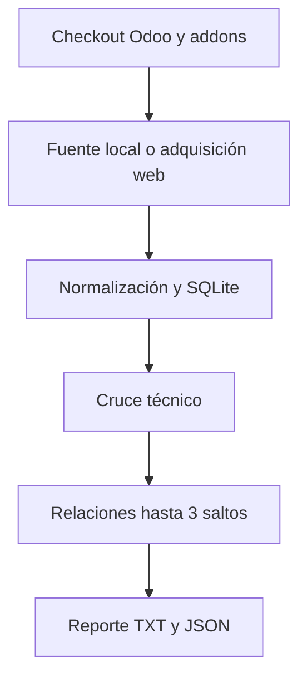

# Funcionamiento de R2

## Objetivo y alcance

R2 centraliza evidencia técnica de cambios entre versiones de Odoo y la cruza con addons para encontrar construcciones potencialmente afectadas antes de migrar. R2.1 implementa planificación/adquisición, normalización/persistencia, cruce, relaciones y reporte. R2.2 ofrece la CLI, el asistente local, consultas, evaluación y pruebas. No usa IA ni ejecuta el código analizado.

## Flujo

### Entrada local

`r2 start` detecta `odoo-bin`, referencias Git y addons por `__manifest__.py`. Antes de comparar versiones, lee los manifiestos y el código de los addons sin ejecutarlos, amplía las dependencias personalizadas disponibles y obtiene dependencias núcleo, modelos y namespaces XML. Con esa evidencia selecciona directorios de addons de Odoo y archivos del framework relacionados. `git diff` compara los SHA elegidos solo sobre esas rutas, excluyendo traducciones, demostraciones, pruebas y descripciones estáticas. El diff filtrado se registra como artefacto local junto con el alcance que lo justificó, se construye una colección compartida y se consulta por cada addon seleccionado.

### Entrada web

`r2 plan` inspecciona estáticamente el addon y propone fuentes. Acquisition valida el catálogo, conserva bytes originales y registra estados `accepted`, `excluded`, `quarantined`, `incomplete`, `failed` o `deleted`. La descarga no decide relevancia.

## Componentes

| Componente | Código | Responsabilidad |
|---|---|---|
| Planificación y adquisición | `r2/adquisition/` | Preparar fuentes, aplicar política y conservar capturas. |
| Normalización y persistencia | `r2/normalization/` | Crear unidades verificables y SQLite esquema 4. |
| Cruce | `r2/crossing/` | Localizar identidades técnicas exactas del addon. |
| Relaciones | `r2/relations/` | Conectar unidades y recorrer de 0 a 3 saltos. |
| Reporte y evaluación | `r2/report.py`, `r2/evaluation/` | Filtrar, presentar, validar y medir. |
| Interfaz R2.2 | `r2/cli.py`, `r2/assistant.py` | Exponer comandos y selección local de múltiples addons. |

## Datos

La colección activa usa `schema_version=4` y `layout=normalized-units`.

| Tabla | Contenido |
|---|---|
| `sources` | Procedencia y bindings de versión. |
| `artifacts` | Artefactos completos y hashes almacenados. |
| `information_units` | Hunks, secciones, texto, PR y otras unidades. |
| `unit_content` | Texto, datos del fragmento y términos, separados de los atributos que usa el grafo. |
| `unit_entities` | Identidades técnicas tipadas. |
| `unit_terms` | Frecuencias y TF-IDF. |
| `unit_search` | Índice FTS5 usado por BM25. |

## Cruce, relaciones y reporte

El cruce lee Python, XML, CSV y manifiestos sin importarlos. Consulta el índice por nombre y tipo; no considera suficiente compartir palabras. El grafo conecta unidades mediante identidades técnicas completas, realiza un recorrido multiorigen no dirigido y conserva distancia mínima, caminos y evidencia de aristas.

El reporte filtra por intervalo, capa y profundidad, deduplica hunks idénticos y calcula totales antes de limitar la vista. Cada resultado conserva fuente, localizador, evidencia del addon y camino. BM25 consulta las mismas unidades elegibles como línea base sin expansión relacional.

## Evaluación

`r2 evaluate` calcula C1, P1, C2, V1 y T1 a partir de referencias y juicios explícitos. Cuando faltan juicios, la métrica es `null`; no se inventa un cero. La validación académica requiere una muestra independiente, no solo pruebas sintéticas.

## Invariantes

- El addon no se ejecuta ni modifica.
- Las versiones avanzan de origen a destino.
- Cada evidencia mantiene procedencia y localizador.
- El alcance del diff local registra addons, dependencias, identificadores, pathspecs y cantidad de archivos incluidos frente al diff completo.
- Las colecciones y reportes no se sobrescriben.
- Se distinguen ausencia limpia, lectura parcial y adquisición fallida.
- Una coincidencia técnica no equivale a una decisión automática de migración.

## Requisitos por componente

- [Planificación y adquisición](docs/componentes/PLANIFICACION_ADQUISICION.md)
- [Normalización y persistencia](docs/componentes/NORMALIZACION_PERSISTENCIA.md)
- [Cruce](docs/componentes/CRUCE.md)
- [Relaciones](docs/componentes/RELACIONES.md)
- [Reporte y evaluación](docs/componentes/REPORTE_EVALUACION.md)
- [Interfaz R2.2](docs/componentes/INTERFAZ_R22.md)
