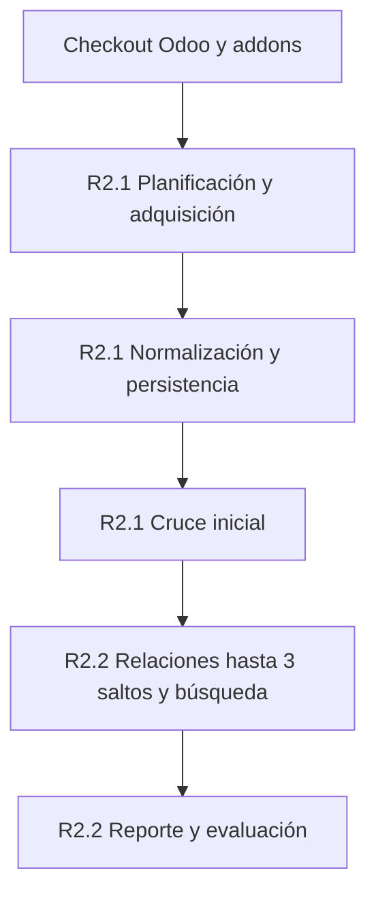

# Funcionamiento de R2

## Objetivo y alcance

R2 centraliza evidencia técnica de cambios entre versiones de Odoo y la cruza con addons para encontrar construcciones potencialmente afectadas antes de migrar. R2.1 comprende planificación, adquisición, normalización, persistencia y cruce inicial. R2.2 comienza con la extracción de relaciones y comprende recorrido, búsqueda, ordenación, reporte, CLI y evaluación. La clasificación depende de la función ejecutada aunque un comando coordine ambos resultados. El código de los addons se lee estáticamente.

## Flujo

### Entrada local

`r2 start` detecta `odoo-bin`, referencias Git y addons por `__manifest__.py`. Antes de comparar versiones, lee los manifiestos y el código de los addons sin ejecutarlos, amplía las dependencias personalizadas disponibles y obtiene dependencias núcleo, modelos y namespaces XML. Con esa evidencia selecciona directorios de addons de Odoo y archivos del framework relacionados. `git diff` compara los SHA elegidos solo sobre esas rutas, excluyendo traducciones, demostraciones, pruebas y descripciones estáticas. El diff filtrado se registra como artefacto local junto con el alcance que lo justificó, se construye una colección compartida y se consulta por cada addon seleccionado.

### Entrada web

`r2 plan` inspecciona estáticamente el addon y propone fuentes. Acquisition valida el catálogo, conserva bytes originales y registra estados `accepted`, `excluded`, `quarantined`, `incomplete`, `failed` o `deleted`. La descarga no decide relevancia.

### Experimento por grupo de cinco addons

`aws-lab/experimentos.py` descarga snapshots de los addons y del núcleo desde GitHub y fija sus SHA. El análisis de los cinco addons delimita el diff local del núcleo. Las dependencias y los nombres técnicos también delimitan diffs de repositorios OCA auxiliares por rutas y SHA. Se planifican y capturan fuentes web complementarias por addon, se deduplican URL y se fusionan los inventarios antes de normalizar. El plan del lote conserva el diff filtrado del núcleo como fuente de comparación.

La colección es compartida por el grupo. R2.1 produce un cruce por addon y un agregado de coincidencias de los cinco en `initial-crossing.json`. R2.2 ejecuta después las consultas y guarda reportes y caminos por addon. La comparación acordada comprende exclusivamente Graph y BM25 por unidades, con el mismo corpus, entrada y límite. El lote permite ejecutar primero un caso con `start --next 1` y avanzar por bloques con `start --next 5`, conservando los casos completados bajo el mismo protocolo.

La consulta BM25 usa términos de las entidades técnicas extraídas del addon.
La coincidencia y la ordenación son léxicas. La extracción de relaciones usa
identidades técnicas tipadas y sus caminos de evidencia.

Los candidatos `[MIG]` y `[FIX]` se recogen antes de la adquisición para
identificar los SHA excluidos. Se examina el historial exclusivo del SHA
destino de los repositorios OCA de los cinco addons y de los repositorios
adicionales revisados. El lote excluye también las fuentes de PR y commits
individuales. Después de consultar, `suggested-links.json` conserva sugerencias
por identificador. El dossier `review/` reúne unidades normalizadas, código y
parches de referencia. `apply-review` valida las decisiones y exporta la matriz
unidad–corrección. `evaluate` calcula las métricas con las consultas archivadas.
El índice por salto y caso enlaza la evidencia y los logs.

## Componentes

| Componente | Código | Responsabilidad |
|---|---|---|
| R2.1 Planificación y adquisición | `r2/adquisition/` | Preparar fuentes, aplicar política y conservar capturas. |
| R2.1 Normalización y persistencia | `r2/normalization/` | Crear unidades verificables y SQLite esquema 4. |
| R2.1 Cruce inicial | `r2/crossing/` | Localizar identidades técnicas exactas del addon. |
| R2.2 Relaciones | `r2/relations/` | Conectar unidades y recorrer de 0 a 3 saltos. |
| R2.2 Reporte y evaluación | `r2/report.py`, `r2/evaluation/` | Filtrar, presentar, validar y medir. |
| Interfaz R2.2 | `r2/cli.py`, `r2/assistant.py` | Exponer comandos y selección local de múltiples addons. |

## Datos

La colección activa usa `schema_version=4` y `layout=normalized-units`.

| Tabla | Contenido |
|---|---|
| `sources` | Procedencia y bindings de versión. |
| `artifacts` | Artefactos completos y hashes almacenados. |
| `information_units` | Hunks, secciones, texto, PR y otras unidades. |
| `unit_content` | Texto, datos del fragmento y términos, separados de los atributos que usa el grafo. |
| `unit_entities` | Identidades técnicas tipadas. |
| `unit_terms` | Frecuencias y TF-IDF. |
| `unit_search` | Índice FTS5 usado por BM25. |

## Cruce, relaciones y reporte

El cruce lee Python, XML, CSV y manifiestos sin importarlos. Consulta el índice por nombre y tipo; no considera suficiente compartir palabras. El grafo conecta unidades mediante identidades técnicas completas, realiza un recorrido multiorigen no dirigido y conserva distancia mínima, caminos y evidencia de aristas.

El reporte filtra por intervalo, capa y profundidad, deduplica hunks idénticos y calcula totales antes de limitar la vista. Puede devolver hunks y secciones de documentación aplicables. Cada resultado cita fuente y localizador. Graph conserva el camino desde el addon, y BM25 guarda la puntuación léxica. El lote reúne hasta diez URL públicas distintas por caso y motor en `recommended-sources.json`.

## Evaluación

`r2 evaluate` calcula C1, P1, C2, V1 y T1 a partir de referencias y juicios explícitos. Cuando faltan juicios, la métrica es `null`; no se inventa un cero. La validación académica requiere una muestra independiente, no solo pruebas sintéticas.

El evaluador de la CLI y el experimento mantienen la comparación entre unidades. C1 usa las correcciones evaluables, incluidas las que carecen de evidencia en la colección. P1 cuenta unidades pertinentes entre las mostradas. C2 usa correcciones explicadas por la primera vista. Se registra quién emitió el juicio, la capa técnica, el componente afectado, los motivos y la incertidumbre. El lote fija treinta MIG admitidos mediante `freeze-sample` y mide la diferencia de P1 sobre sus consultas pareadas.

`timing.json` registra tiempos de consulta y de etapa por repetición. `relations_seconds` mide extracción, recorrido y validación del grafo. `bm25_units_seconds` mide la consulta léxica. Descarga, normalización y construcción de índices son preparación. Al terminar el caso, el contenedor registra los resultados de ambos motores. `statistics.json` y `bars.txt` conservan conteos estructurales de nodos, identidades y aristas. La pertinencia se establece en los juicios.

## Invariantes

- El addon no se ejecuta ni modifica.
- Las versiones avanzan de origen a destino.
- Cada evidencia mantiene procedencia y localizador.
- El alcance del diff local registra addons, dependencias, identificadores, pathspecs y cantidad de archivos incluidos frente al diff completo.
- Las colecciones y reportes no se sobrescriben.
- Se distinguen ausencia limpia, lectura parcial y adquisición fallida.
- Una coincidencia técnica no equivale a una decisión automática de migración.

## Requisitos por componente

- [Planificación y adquisición](docs/componentes/PLANIFICACION_ADQUISICION.md)
- [Normalización y persistencia](docs/componentes/NORMALIZACION_PERSISTENCIA.md)
- [Cruce](docs/componentes/CRUCE.md)
- [Relaciones](docs/componentes/RELACIONES.md)
- [Reporte y evaluación](docs/componentes/REPORTE_EVALUACION.md)
- [Interfaz R2.2](docs/componentes/INTERFAZ_R22.md)
